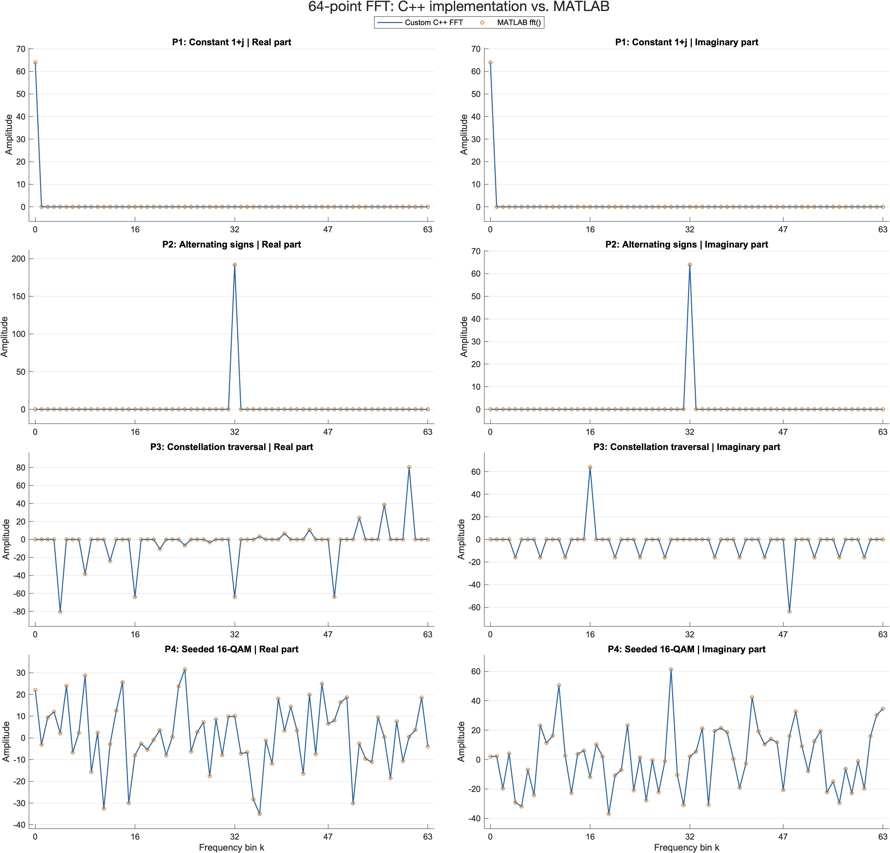
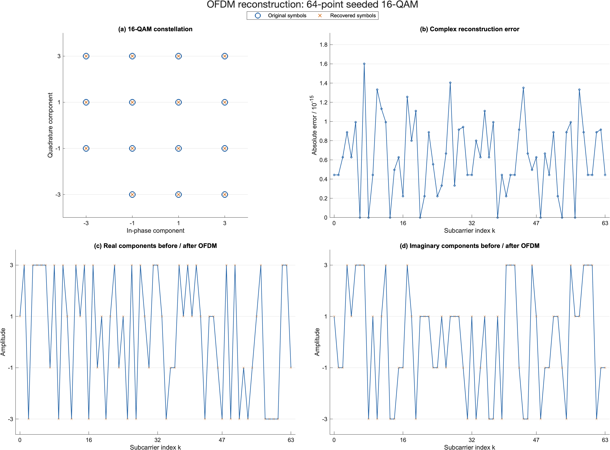

# FFT / IFFT in C++

**A from-scratch C++17 FFT/IFFT implementation with arbitrary-length transforms and an ideal-channel OFDM demonstration.**

The transform, 16-QAM pattern generation, OFDM signal processing, reconstruction checks, and CSV export are implemented in **C++**. MATLAB is used only as an independent numerical reference and to produce publication-quality figures. The C++ programs build and run without MATLAB or third-party DSP libraries.

## What is implemented

- Iterative radix-2 decimation-in-time FFT with bit reversal and in-place butterflies for power-of-two lengths.
- Bluestein's chirp-z reduction for other positive transform lengths.
- MATLAB-compatible conventions: an unscaled forward transform with negative exponential, and an inverse transform with positive exponential divided by N.
- Four deterministic 16-QAM input patterns: constant, alternating signs, constellation traversal, and seeded data.
- An ideal-channel `16-QAM → IFFT → channel → FFT → symbol decisions` demonstration.
- Independent C++ direct-DFT tests, round trips, Parseval energy checks, impulse/zero inputs, and empty-input rejection.

## Build and run

A C++17 compiler and Make are sufficient. Tested locally with Apple Clang; CI builds with GCC on Linux and Clang on macOS.

```sh
make all test
./bin/ofdm all rerun/default       # N = 3, 32, 64, 127, 128
./bin/ofdm 3 rerun/N3             # non-power-of-two transform
./bin/ofdm 127 rerun/N127
```

The demo accepts `ofdm [N|all] [output_directory]`. CSV output contains complex input values, forward/inverse results, OFDM reconstruction, EVM, and symbol-error counts. Use a separate output directory to retain the checked-in measurements. `make run` writes new output to `results/`.

## Measured results

The retained dataset contains four patterns at each of N = 3, 32, 64, 127, and 128. All 20 ideal-channel cases recover every transmitted symbol. Independent MATLAB FFT/IFFT comparisons use a maximum absolute error threshold of `1e-10`; the exact measured values are in [results/matlab_summary.csv](results/matlab_summary.csv).





Ten MATLAB figures are retained as PNG exports and editable `.fig` files. MATLAB does not implement the C++ receiver or transform under test.

To verify the retained measurements and reproduce the figures in MATLAB:

```matlab
addpath('matlab');
verify_fft;
plot_fft_figures;
```

The plotter expects all five retained transform lengths. If replacing the measurement dataset, first generate the corresponding C++ CSVs for each length.

## Layout

| Path | Contents |
| --- | --- |
| `src/fft.cpp`, `src/fft.hpp` | C++ FFT/IFFT library |
| `src/main.cpp` | C++ 16-QAM / ideal-channel OFDM demo |
| `tests/test.cpp` | Independent numerical tests written in C++ |
| `results/` | Retained C++ measurements and MATLAB reference CSVs |
| `matlab/` | Reference verification and figure generation |
| `figures_matlab/` | PNG and editable MATLAB FIG outputs |

This demo isolates transform accuracy and ideal-channel reconstruction. Noise, cyclic prefixes, timing acquisition, and multipath are developed in [ofdm-baseband-cpp](https://github.com/Joe05520/ofdm-baseband-cpp).

## 中文說明

這是以 **C++17 從零實作**的 FFT / IFFT 專案，包含 radix-2、Bluestein 任意長度轉換，以及 16-QAM 理想通道 OFDM 範例。核心演算法、訊號處理和測試均以 C++ 完成；MATLAB 僅用來獨立核對數值與繪圖，執行 C++ 程式不需要 MATLAB。

Author: Jin-Teng Sung · [Joe05520](https://github.com/Joe05520)
